<div align="center">
<picture>
  <source media="(prefers-color-scheme: dark)" srcset="assets/banners/header-dark.svg">
  <source media="(prefers-color-scheme: light)" srcset="assets/banners/header-light.svg">
  
</picture>
</div>

<p align="center">
  <a href="scripts/ascii/">
    <picture>
      <source media="(prefers-color-scheme: dark)" srcset="assets/ascii/portrait-dark.svg">
      <source media="(prefers-color-scheme: light)" srcset="assets/ascii/portrait-light.svg">
      
    </picture>
  </a>
  <br>
  <sub>Yes, the portrait is made of text. <a href="scripts/ascii/">See how it is built</a>.</sub>
</p>

<p align="center">
  <picture>
    <source media="(prefers-color-scheme: dark)" srcset="assets/banners/typing-dark.svg">
    <source media="(prefers-color-scheme: light)" srcset="assets/banners/typing-light.svg">
    
  </picture>
</p>

## `rajdip@hitk:~$ whoami`

```yaml
name: Rajdip Dhar
education: B.Tech Computer Science Engineering @ Heritage Institute of Technology, Kolkata (2026-2030)
timezone: Asia/Kolkata (IST)
now: building with TypeScript, Kotlin, C and Python
focus: [full-stack, Android, game dev, Web3]
exploring: AI / LLM apps and automation
looking_for: internships and collaborations
fun_fact: "my README waves at you - yes, it's code"
```

<details>
<summary>📜 More about me</summary>

- **Programs & coursework:** Autumn Internship Program on Data Science 2026 (Python, data analysis, visualisation, ML), data analytics assignments (Streamlit COVID-19 dashboard), Python Crash Course (pygame, Matplotlib/Plotly, Django).
- **Clubs & hackathons:** <!-- TODO_RAJDIP: clubs, hackathons, achievements (README.md "More about me") -->coming soon.

</details>

## `rajdip@hitk:~$ cat stack.txt`

**Using**<br>
<a href="https://skillicons.dev"></a>

**Learning**<br>
<a href="https://skillicons.dev"></a>
&nbsp;<sub>plus ML / data science and LLM apps</sub>

<!-- TODO_RAJDIP: review the Using / Learning rows; they are limited to what the public repos show. -->

## `rajdip@hitk:~$ git stats`

<table>
  <tr>
    <td align="center" width="50%">
      <picture>
        <source media="(prefers-color-scheme: dark)" srcset="assets/cards/stats-dark.svg">
        <source media="(prefers-color-scheme: light)" srcset="assets/cards/stats-light.svg">
        
      </picture>
    </td>
    <td align="center" width="50%">
      <picture>
        <source media="(prefers-color-scheme: dark)" srcset="assets/cards/langs-dark.svg">
        <source media="(prefers-color-scheme: light)" srcset="assets/cards/langs-light.svg">
        
      </picture>
    </td>
  </tr>
  <tr>
    <td align="center" colspan="2">
      <picture>
        <source media="(prefers-color-scheme: dark)" srcset="profile/streak-dark.svg">
        <source media="(prefers-color-scheme: light)" srcset="profile/streak-light.svg">
        
      </picture>
    </td>
  </tr>
</table>

<p align="center">
  
  
</p>

## `rajdip@hitk:~$ ./contrib --city`

<p align="center">
  <picture>
    <source media="(prefers-color-scheme: dark)" srcset="profile-3d-contrib/profile-neon-night.svg">
    <source media="(prefers-color-scheme: light)" srcset="profile-3d-contrib/profile-neon-day.svg">
    
  </picture>
</p>

<details>
<summary>🎮 Watch my contributions get eaten</summary>

<p align="center">
  <picture>
    <source media="(prefers-color-scheme: dark)" srcset="https://raw.githubusercontent.com/RajdipDhar2007/RajdipDhar2007/output/github-snake-dark.svg">
    <source media="(prefers-color-scheme: light)" srcset="https://raw.githubusercontent.com/RajdipDhar2007/RajdipDhar2007/output/github-snake.svg">
    
  </picture>
</p>

</details>

## `rajdip@hitk:~$ ls projects/`

<table>
  <tr>
    <td width="50%" valign="top">
      <b><a href="https://github.com/RajdipDhar2007/UltimateCraft">UltimateCraft</a></b><br>
      Open-world voxel survival sandbox written from scratch in C / OpenGL: hand-built physics, real animal sounds, 5 realms and a story.<br>
       <br>
      <!-- TODO_RAJDIP: demo GIF for UltimateCraft (e.g. assets/projects/ultimatecraft.gif, < 2 MB) -->
      <a href="https://github.com/RajdipDhar2007/UltimateCraft">Repo</a> · <a href="https://github.com/RajdipDhar2007/UltimateCraft/releases/latest">Live</a><!-- TODO_RAJDIP: · Write-up -->
    </td>
    <td width="50%" valign="top">
      <b><a href="https://github.com/RajdipDhar2007/Loci">Loci</a></b><br>
      Graph anything in one living 3D space: 2D, implicit, inequality, parametric and 3D surfaces.<br>
      <br>
      <!-- TODO_RAJDIP: demo GIF for Loci -->
      <a href="https://github.com/RajdipDhar2007/Loci">Repo</a><!-- TODO_RAJDIP: · Live · Write-up -->
    </td>
  </tr>
  <tr>
    <td width="50%" valign="top">
      <b><a href="https://github.com/RajdipDhar2007/AttendTrack">AttendTrack</a></b><br>
      Android attendance tracker: bunk calculator, timetable, exams, study planner and a Gemini AI copilot.<br>
       <br>
      <!-- TODO_RAJDIP: demo GIF for AttendTrack -->
      <a href="https://github.com/RajdipDhar2007/AttendTrack">Repo</a><!-- TODO_RAJDIP: · Live · Write-up -->
    </td>
    <td width="50%" valign="top">
      <b><a href="https://github.com/RajdipDhar2007/Meridian">Meridian</a></b><br>
      Instrument-panel weather app with a live GPS-driven sky. No API keys needed.<br>
        <br>
      <!-- TODO_RAJDIP: demo GIF for Meridian -->
      <a href="https://github.com/RajdipDhar2007/Meridian">Repo</a><!-- TODO_RAJDIP: · Live · Write-up -->
    </td>
  </tr>
</table>

<sub>More on my <a href="https://github.com/RajdipDhar2007?tab=repositories">repositories</a> page: TaskFlow, MathForge, Rack Up (Web3 game on Base Sepolia), Periodic Table and more.</sub>

## `rajdip@hitk:~$ ./play --interactive`

> Everything here is event-driven: click a link, submit the pre-filled issue, and a GitHub Action updates this page **about 60 seconds later**. Nothing runs in your browser.

### Tic-tac-toe vs my bot

<!--START_SECTION:game-->
<div align="center">
<br>
<a href="https://github.com/RajdipDhar2007/RajdipDhar2007/issues/new?title=ttt%7Cmove%7C0&body=Just%20press%20%2A%2ASubmit%20new%20issue%2A%2A.%20The%20bot%20replies%20in%20about%20a%20minute.%20Don%27t%20change%20the%20title."></a><a href="https://github.com/RajdipDhar2007/RajdipDhar2007/issues/new?title=ttt%7Cmove%7C1&body=Just%20press%20%2A%2ASubmit%20new%20issue%2A%2A.%20The%20bot%20replies%20in%20about%20a%20minute.%20Don%27t%20change%20the%20title."></a><a href="https://github.com/RajdipDhar2007/RajdipDhar2007/issues/new?title=ttt%7Cmove%7C2&body=Just%20press%20%2A%2ASubmit%20new%20issue%2A%2A.%20The%20bot%20replies%20in%20about%20a%20minute.%20Don%27t%20change%20the%20title."></a><br>
<a href="https://github.com/RajdipDhar2007/RajdipDhar2007/issues/new?title=ttt%7Cmove%7C3&body=Just%20press%20%2A%2ASubmit%20new%20issue%2A%2A.%20The%20bot%20replies%20in%20about%20a%20minute.%20Don%27t%20change%20the%20title."></a><a href="https://github.com/RajdipDhar2007/RajdipDhar2007/issues/new?title=ttt%7Cmove%7C4&body=Just%20press%20%2A%2ASubmit%20new%20issue%2A%2A.%20The%20bot%20replies%20in%20about%20a%20minute.%20Don%27t%20change%20the%20title."></a><a href="https://github.com/RajdipDhar2007/RajdipDhar2007/issues/new?title=ttt%7Cmove%7C5&body=Just%20press%20%2A%2ASubmit%20new%20issue%2A%2A.%20The%20bot%20replies%20in%20about%20a%20minute.%20Don%27t%20change%20the%20title."></a><br>
<a href="https://github.com/RajdipDhar2007/RajdipDhar2007/issues/new?title=ttt%7Cmove%7C6&body=Just%20press%20%2A%2ASubmit%20new%20issue%2A%2A.%20The%20bot%20replies%20in%20about%20a%20minute.%20Don%27t%20change%20the%20title."></a><a href="https://github.com/RajdipDhar2007/RajdipDhar2007/issues/new?title=ttt%7Cmove%7C7&body=Just%20press%20%2A%2ASubmit%20new%20issue%2A%2A.%20The%20bot%20replies%20in%20about%20a%20minute.%20Don%27t%20change%20the%20title."></a><a href="https://github.com/RajdipDhar2007/RajdipDhar2007/issues/new?title=ttt%7Cmove%7C8&body=Just%20press%20%2A%2ASubmit%20new%20issue%2A%2A.%20The%20bot%20replies%20in%20about%20a%20minute.%20Don%27t%20change%20the%20title."></a>

<sub>humans 0 &#183; bot 0 &#183; draws 0 &#183; you are X, click a square &#183; the board updates ~60 s after you submit</sub>
</div>
<sub>No finished games yet - be the first on the leaderboard.</sub>
<!--END_SECTION:game-->

### Poll

<!--START_SECTION:poll-->
<div align="center">
<b>What should I build next?</b><br>
<picture><source media="(prefers-color-scheme: dark)" srcset="assets/cards/poll-dark.svg"><source media="(prefers-color-scheme: light)" srcset="assets/cards/poll-light.svg"></picture><br>
<sub>vote: <a href="https://github.com/RajdipDhar2007/RajdipDhar2007/issues/new?title=poll%7Cvote%7C0&body=Press%20Submit%20new%20issue%20to%20cast%20your%20vote%20%28one%20per%20person%29.">An AI / LLM app</a> &#183; <a href="https://github.com/RajdipDhar2007/RajdipDhar2007/issues/new?title=poll%7Cvote%7C1&body=Press%20Submit%20new%20issue%20to%20cast%20your%20vote%20%28one%20per%20person%29.">A developer tool or CLI</a> &#183; <a href="https://github.com/RajdipDhar2007/RajdipDhar2007/issues/new?title=poll%7Cvote%7C2&body=Press%20Submit%20new%20issue%20to%20cast%20your%20vote%20%28one%20per%20person%29.">A game or creative project</a></sub><br>
<sub>0 votes so far &#183; one vote per person &#183; the chart updates ~60 s after you vote</sub>
</div>
<!--END_SECTION:poll-->

### Guestbook

<!--START_SECTION:guestbook-->
> *No entries yet - be the first!*

<sub><a href="https://github.com/RajdipDhar2007/RajdipDhar2007/issues/new?template=guestbook.yml">&#9998; Sign the guestbook</a> &#183; max 140 characters, no links &#183; shows up ~60 s after you submit</sub>
<!--END_SECTION:guestbook-->

## `rajdip@hitk:~$ tail -f activity.log`

<!--START_SECTION:greeting-->
<sub>&#127769; Night in Kolkata &mdash; Rajdip is probably debugging</sub>
<!--END_SECTION:greeting-->

<!--START_SECTION:activity-->
<!--END_SECTION:activity-->

<!-- Optional blocks, disabled until you enable them (see the commented jobs in .github/workflows/activity.yml).
Paste inside a <details> block when ready:
  blog posts : START_SECTION:blog-post-workflow / END_SECTION:blog-post-workflow markers
  WakaTime   : START_SECTION:waka / END_SECTION:waka markers
  Spotify    : TODO_RAJDIP now-playing SVG (needs your own Spotify app keys)
-->

## `rajdip@hitk:~$ ./contact --open`

<p align="center">
  <a href="mailto:rajdipdharofficial@gmail.com"></a>
  <a href="https://github.com/RajdipDhar2007"></a>
  <!-- TODO_RAJDIP: add LinkedIn, Portfolio, LeetCode / Codeforces and X badges, e.g.
  <a href="https://www.linkedin.com/in/YOUR-HANDLE"></a> -->
</p>

<p align="center">📬 Fastest reply: email · Open to internships</p>

<div align="center">
<picture>
  <source media="(prefers-color-scheme: dark)" srcset="assets/banners/footer-dark.svg">
  <source media="(prefers-color-scheme: light)" srcset="assets/banners/footer-light.svg">
  
</picture>
<br>

<br>
<!--START_SECTION:stamp-->
<sub>Last auto-updated: 2026-10-16 00:57 IST</sub>
<!--END_SECTION:stamp-->
</div>
