

<picture><source media="(prefers-color-scheme: dark)" srcset="assets/banners/header-dark.svg"><source media="(prefers-color-scheme: light)" srcset="assets/banners/header-light.svg"></picture>

<a href="scripts/ascii/"><picture><source media="(prefers-color-scheme: dark)" srcset="assets/ascii/portrait-dark.svg"><source media="(prefers-color-scheme: light)" srcset="assets/ascii/portrait-light.svg">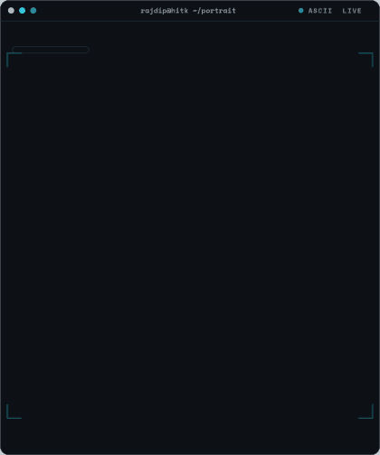</picture></a>

<picture><source media="(prefers-color-scheme: dark)" srcset="assets/hero/hello-dark.svg"><source media="(prefers-color-scheme: light)" srcset="assets/hero/hello-light.svg"></picture> 
<picture><source media="(prefers-color-scheme: dark)" srcset="assets/hero/roles-dark.svg"><source media="(prefers-color-scheme: light)" srcset="assets/hero/roles-light.svg"></picture> 
<picture><source media="(prefers-color-scheme: dark)" srcset="assets/hero/chips-dark.svg"><source media="(prefers-color-scheme: light)" srcset="assets/hero/chips-light.svg"></picture>

<picture><source media="(prefers-color-scheme: dark)" srcset="assets/hero/welcome-dark.svg"><source media="(prefers-color-scheme: light)" srcset="assets/hero/welcome-light.svg"></picture> 
<a href="https://github.com/RajdipDhar2007"><picture><source media="(prefers-color-scheme: dark)" srcset="assets/hero/btn-follow-dark.svg"><source media="(prefers-color-scheme: light)" srcset="assets/hero/btn-follow-light.svg"></picture></a><a href="https://github.com/RajdipDhar2007?tab=repositories"><picture><source media="(prefers-color-scheme: dark)" srcset="assets/hero/btn-work-dark.svg"><source media="(prefers-color-scheme: light)" srcset="assets/hero/btn-work-light.svg"></picture></a>

 

<picture><source media="(prefers-color-scheme: dark)" srcset="assets/sections/ticker-dark.svg"><source media="(prefers-color-scheme: light)" srcset="assets/sections/ticker-light.svg"></picture>

<picture><source media="(prefers-color-scheme: dark)" srcset="assets/sections/divider-dark.svg"><source media="(prefers-color-scheme: light)" srcset="assets/sections/divider-light.svg"></picture>

<picture><source media="(prefers-color-scheme: dark)" srcset="assets/titles/about-dark.svg"><source media="(prefers-color-scheme: light)" srcset="assets/titles/about-light.svg"></picture>

<picture><source media="(prefers-color-scheme: dark)" srcset="assets/sections/about-dark.svg"><source media="(prefers-color-scheme: light)" srcset="assets/sections/about-light.svg"></picture>

<!-- TODO_RAJDIP: clubs, hackathons and achievements can become a new card or a short list here. -->

<picture><source media="(prefers-color-scheme: dark)" srcset="assets/sections/divider2-dark.svg"><source media="(prefers-color-scheme: light)" srcset="assets/sections/divider2-light.svg"></picture>

<picture><source media="(prefers-color-scheme: dark)" srcset="assets/titles/toolbox-dark.svg"><source media="(prefers-color-scheme: light)" srcset="assets/titles/toolbox-light.svg"></picture>

<picture><source media="(prefers-color-scheme: dark)" srcset="assets/sections/toolbox-dark.svg"><source media="(prefers-color-scheme: light)" srcset="assets/sections/toolbox-light.svg">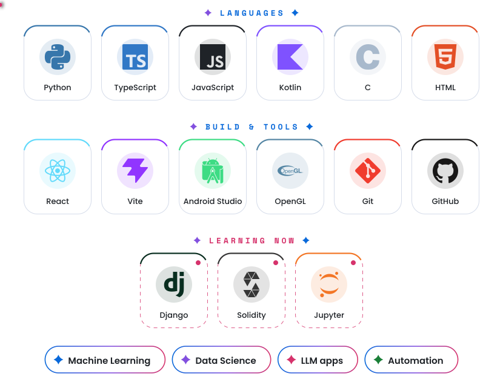</picture>

<!-- TODO_RAJDIP: review the toolbox tiles (poster.work.ROWS); they only list what the public repos show. -->

<picture><source media="(prefers-color-scheme: dark)" srcset="assets/sections/ticker2-dark.svg"><source media="(prefers-color-scheme: light)" srcset="assets/sections/ticker2-light.svg"></picture>

<picture><source media="(prefers-color-scheme: dark)" srcset="assets/sections/divider-dark.svg"><source media="(prefers-color-scheme: light)" srcset="assets/sections/divider-light.svg"></picture>

<picture><source media="(prefers-color-scheme: dark)" srcset="assets/titles/work-dark.svg"><source media="(prefers-color-scheme: light)" srcset="assets/titles/work-light.svg"></picture>

<table>
<tr>
<td width="50%" align="center" valign="top">
<a href="https://github.com/RajdipDhar2007/UltimateCraft"><picture><source media="(prefers-color-scheme: dark)" srcset="assets/projects/ultimatecraft-dark.svg"><source media="(prefers-color-scheme: light)" srcset="assets/projects/ultimatecraft-light.svg"></picture></a> 
<a href="https://github.com/RajdipDhar2007/UltimateCraft/releases/download/v5.1.0/UltimateCraft-5.1.0-windows.zip"><picture><source media="(prefers-color-scheme: dark)" srcset="assets/projects/ultimatecraft-band-dark.svg"><source media="(prefers-color-scheme: light)" srcset="assets/projects/ultimatecraft-band-light.svg"></picture></a>
</td>
<td width="50%" align="center" valign="top">
<a href="https://github.com/RajdipDhar2007/Loci"><picture><source media="(prefers-color-scheme: dark)" srcset="assets/projects/loci-dark.svg"><source media="(prefers-color-scheme: light)" srcset="assets/projects/loci-light.svg">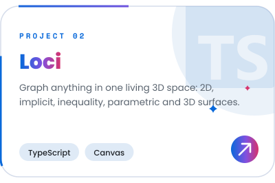</picture></a> 
<a href="https://github.com/RajdipDhar2007/Loci"><picture><source media="(prefers-color-scheme: dark)" srcset="assets/projects/loci-band-dark.svg"><source media="(prefers-color-scheme: light)" srcset="assets/projects/loci-band-light.svg"></picture></a>
</td>
</tr>
<tr>
<td width="50%" align="center" valign="top">
<a href="https://github.com/RajdipDhar2007/AttendTrack"><picture><source media="(prefers-color-scheme: dark)" srcset="assets/projects/attendtrack-dark.svg"><source media="(prefers-color-scheme: light)" srcset="assets/projects/attendtrack-light.svg"></picture></a> 
<a href="https://github.com/RajdipDhar2007/AttendTrack/releases/latest/download/AttendTrack.apk"><picture><source media="(prefers-color-scheme: dark)" srcset="assets/projects/attendtrack-band-dark.svg"><source media="(prefers-color-scheme: light)" srcset="assets/projects/attendtrack-band-light.svg"></picture></a>
</td>
<td width="50%" align="center" valign="top">
<a href="https://github.com/RajdipDhar2007/Meridian"><picture><source media="(prefers-color-scheme: dark)" srcset="assets/projects/meridian-dark.svg"><source media="(prefers-color-scheme: light)" srcset="assets/projects/meridian-light.svg"></picture></a> 
<a href="https://github.com/RajdipDhar2007/Meridian"><picture><source media="(prefers-color-scheme: dark)" srcset="assets/projects/meridian-band-dark.svg"><source media="(prefers-color-scheme: light)" srcset="assets/projects/meridian-band-light.svg"></picture></a>
</td>
</tr>
</table>

<a href="https://github.com/RajdipDhar2007?tab=repositories"><picture><source media="(prefers-color-scheme: dark)" srcset="assets/sections/more-dark.svg"><source media="(prefers-color-scheme: light)" srcset="assets/sections/more-light.svg">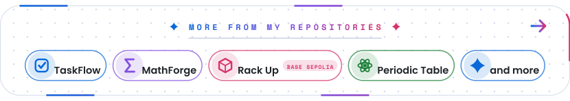</picture></a>

<a href="https://github.com/RajdipDhar2007/TaskFlow"><picture><source media="(prefers-color-scheme: dark)" srcset="assets/sections/more-0-dark.svg"><source media="(prefers-color-scheme: light)" srcset="assets/sections/more-0-light.svg"></picture></a>
<a href="https://github.com/RajdipDhar2007/MathForge"><picture><source media="(prefers-color-scheme: dark)" srcset="assets/sections/more-1-dark.svg"><source media="(prefers-color-scheme: light)" srcset="assets/sections/more-1-light.svg"></picture></a>
<a href="https://github.com/RajdipDhar2007/Rack_Up-Onchain_Hi-Lo"><picture><source media="(prefers-color-scheme: dark)" srcset="assets/sections/more-2-dark.svg"><source media="(prefers-color-scheme: light)" srcset="assets/sections/more-2-light.svg"></picture></a>
<a href="https://github.com/RajdipDhar2007/Periodic-Table"><picture><source media="(prefers-color-scheme: dark)" srcset="assets/sections/more-3-dark.svg"><source media="(prefers-color-scheme: light)" srcset="assets/sections/more-3-light.svg"></picture></a>
<a href="https://github.com/RajdipDhar2007?tab=repositories"><picture><source media="(prefers-color-scheme: dark)" srcset="assets/sections/more-4-dark.svg"><source media="(prefers-color-scheme: light)" srcset="assets/sections/more-4-light.svg"></picture></a>

<picture><source media="(prefers-color-scheme: dark)" srcset="assets/sections/divider2-dark.svg"><source media="(prefers-color-scheme: light)" srcset="assets/sections/divider2-light.svg"></picture>

<picture><source media="(prefers-color-scheme: dark)" srcset="assets/titles/stats-dark.svg"><source media="(prefers-color-scheme: light)" srcset="assets/titles/stats-light.svg"></picture>

<picture><source media="(prefers-color-scheme: dark)" srcset="assets/stats/dashboard-dark.svg?v=1792168654"><source media="(prefers-color-scheme: light)" srcset="assets/stats/dashboard-light.svg?v=1792168654"></picture>

<picture><source media="(prefers-color-scheme: dark)" srcset="assets/sections/divider-dark.svg"><source media="(prefers-color-scheme: light)" srcset="assets/sections/divider-light.svg"></picture>

<picture><source media="(prefers-color-scheme: dark)" srcset="assets/titles/city-dark.svg"><source media="(prefers-color-scheme: light)" srcset="assets/titles/city-light.svg"></picture>

<picture><source media="(prefers-color-scheme: dark)" srcset="assets/3d/contribution-dark.svg?v=1792166475"><source media="(prefers-color-scheme: light)" srcset="assets/3d/contribution-light.svg?v=1792166475"></picture>

<picture><source media="(prefers-color-scheme: dark)" srcset="assets/sections/divider2-dark.svg"><source media="(prefers-color-scheme: light)" srcset="assets/sections/divider2-light.svg"></picture>

<picture><source media="(prefers-color-scheme: dark)" srcset="assets/titles/activity-dark.svg"><source media="(prefers-color-scheme: light)" srcset="assets/titles/activity-light.svg"></picture>

<picture><source media="(prefers-color-scheme: dark)" srcset="assets/live/greeting-dark.svg?v=1792166474"><source media="(prefers-color-scheme: light)" srcset="assets/live/greeting-light.svg?v=1792166474"></picture>

<picture><source media="(prefers-color-scheme: dark)" srcset="assets/sections/divider-dark.svg"><source media="(prefers-color-scheme: light)" srcset="assets/sections/divider-light.svg"></picture>

<picture><source media="(prefers-color-scheme: dark)" srcset="assets/titles/play-dark.svg"><source media="(prefers-color-scheme: light)" srcset="assets/titles/play-light.svg"></picture>

<a href="https://rajdipdhar2007.github.io/RajdipDhar2007/"><picture><source media="(prefers-color-scheme: dark)" srcset="assets/sections/arcade-dark.svg"><source media="(prefers-color-scheme: light)" srcset="assets/sections/arcade-light.svg"></picture></a>

<picture><source media="(prefers-color-scheme: dark)" srcset="assets/sections/divider2-dark.svg"><source media="(prefers-color-scheme: light)" srcset="assets/sections/divider2-light.svg"></picture>

<picture><source media="(prefers-color-scheme: dark)" srcset="assets/titles/connect-dark.svg"><source media="(prefers-color-scheme: light)" srcset="assets/titles/connect-light.svg"></picture>

<a href="mailto:rajdipdharofficial@gmail.com"><picture><source media="(prefers-color-scheme: dark)" srcset="assets/contact/email-dark.svg"><source media="(prefers-color-scheme: light)" srcset="assets/contact/email-light.svg"></picture></a>
<a href="https://github.com/RajdipDhar2007"><picture><source media="(prefers-color-scheme: dark)" srcset="assets/contact/github-dark.svg"><source media="(prefers-color-scheme: light)" srcset="assets/contact/github-light.svg">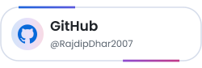</picture></a>
<!-- TODO_RAJDIP: add LinkedIn, portfolio, LeetCode / Codeforces and X pills (see contact_pill() in scripts/poster/hero.py) -->

<a href="https://github.com/RajdipDhar2007/RajdipDhar2007"><picture><source media="(prefers-color-scheme: dark)" srcset="assets/sections/star-dark.svg"><source media="(prefers-color-scheme: light)" srcset="assets/sections/star-light.svg"></picture></a>

<picture><source media="(prefers-color-scheme: dark)" srcset="assets/banners/footer-dark.svg"><source media="(prefers-color-scheme: light)" srcset="assets/banners/footer-light.svg"></picture>

